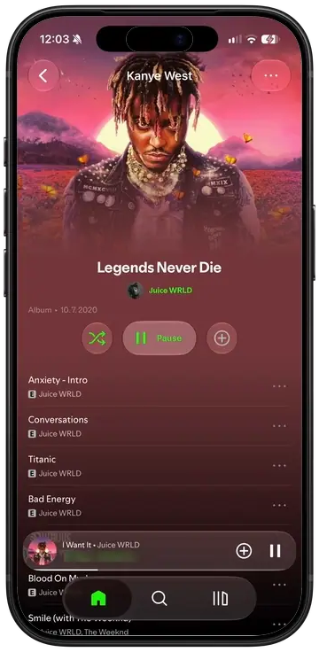
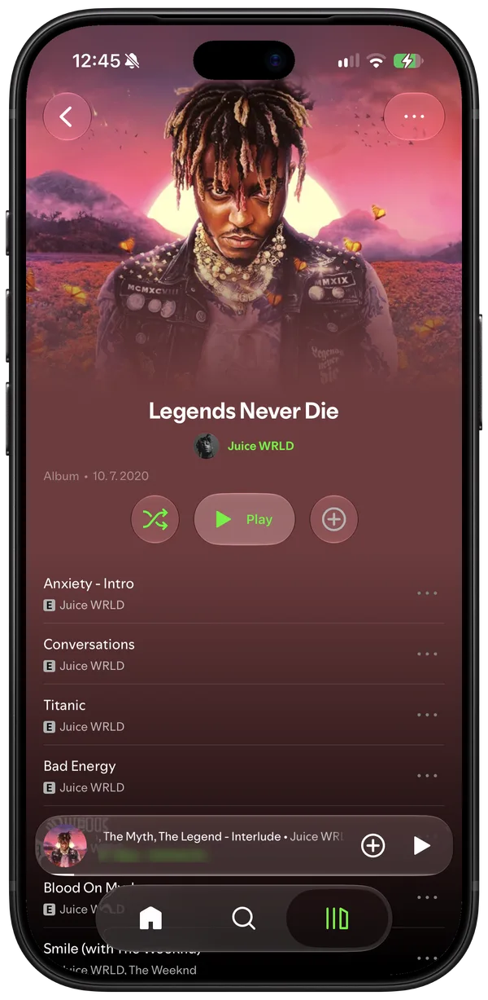
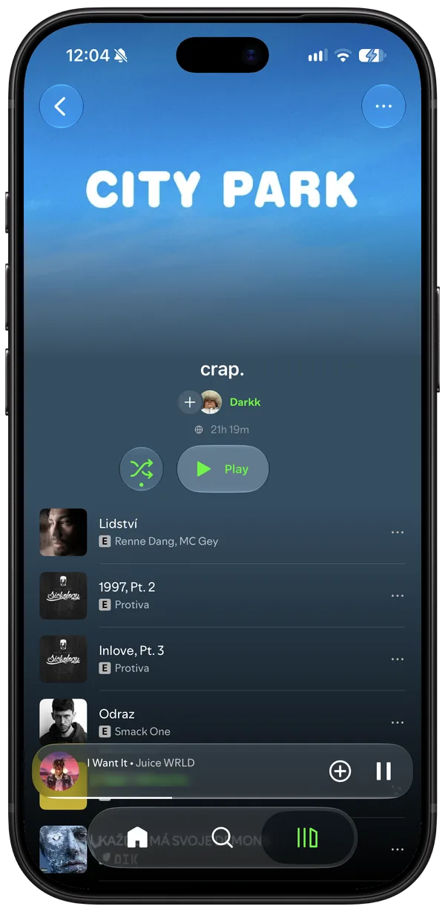
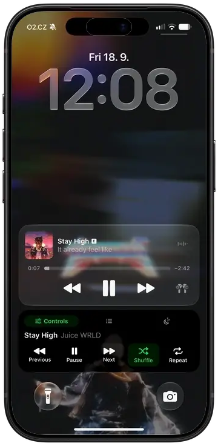
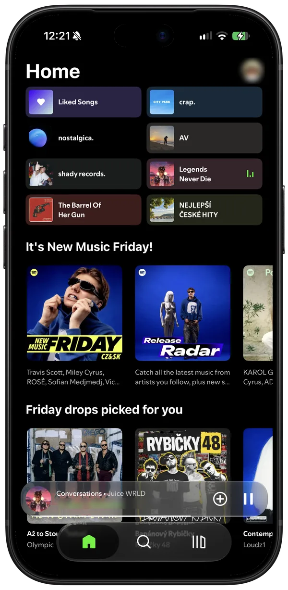
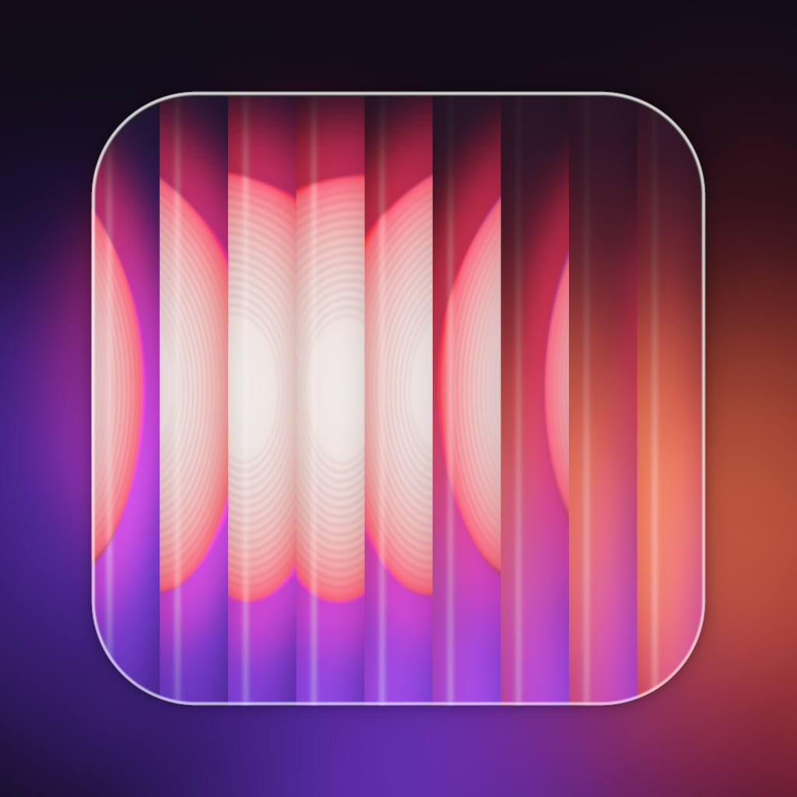
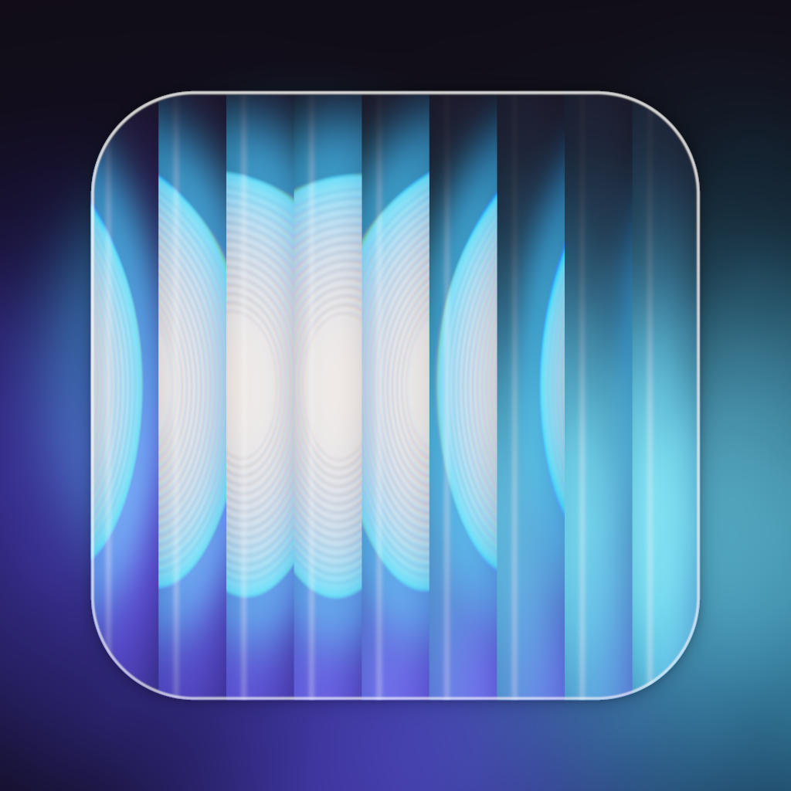
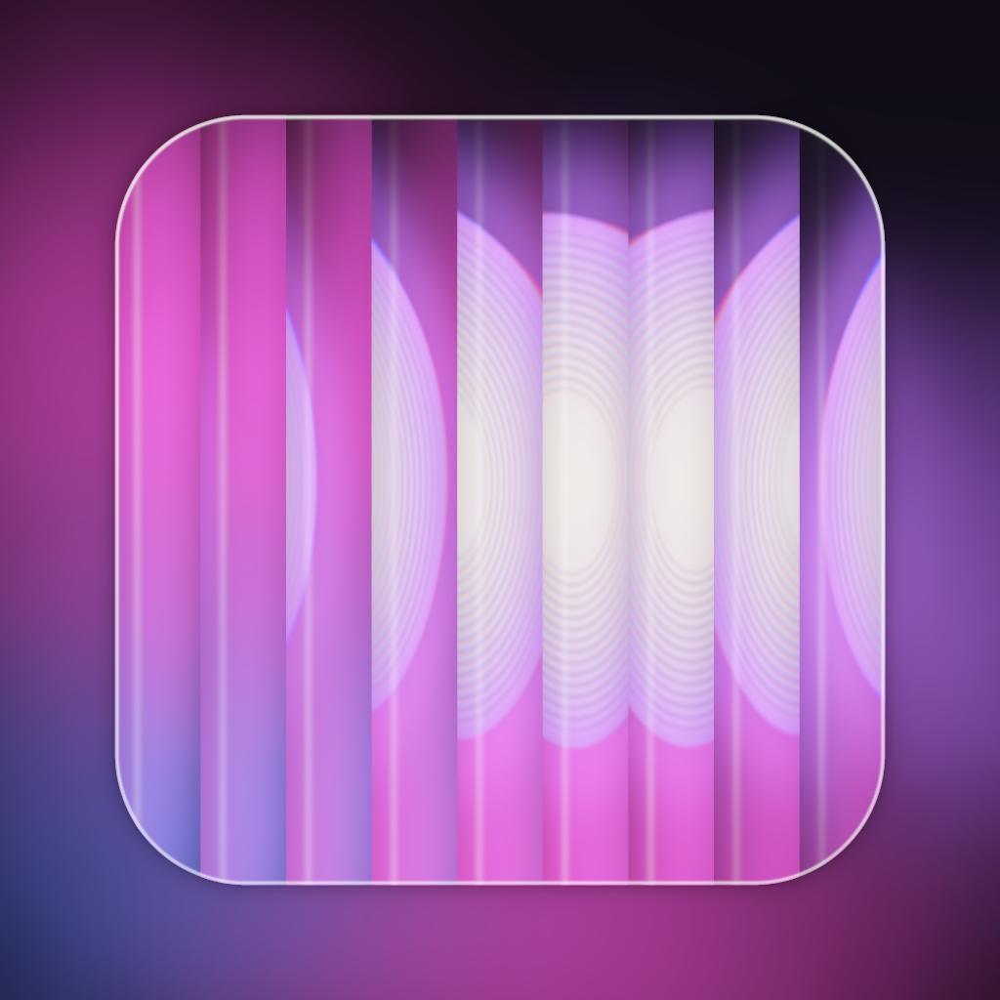

<p align="right"><a href="README.md">한국어</a> · <b>English</b></p>

<p align="center"></p>

<h1 align="center">Retrine</h1>

<p align="center">
  <strong>A Liquid Glass player and synced lyrics for Spotify on iOS.</strong><br>
  Build and sign your own Spotify IPA to use it without a jailbreak.
</p>

<p align="center">
  
  
  
  <a href="LICENSE"></a>
  <a href="https://github.com/oneulddu/Retrine/releases"></a>
</p>

<p align="center">
  <a href="#two-looks">Choose a look</a> ·
  <a href="#player-and-lyrics">Player and lyrics</a> ·
  <a href="#build-it-yourself">Build</a> ·
  <a href="#signing-and-bundle-id">Signing</a> ·
  <a href="docs/tweaks.md">Developer guide</a> ·
  <a href="https://github.com/oneulddu/Retrine/issues/new/choose">Report a bug</a>
</p>

Retrine is a Theos tweak (Objective-C + Logos) forked from [Vitrine](https://github.com/My-Name-Is-Jeff/vitrine). **Releases do not include an IPA.** Build from your own decrypted copy of a supported Spotify IPA using GitHub Actions or a Mac.

## Screenshots

<table align="center">
  <tr>
    <td align="center"><a href="docs/screenshots/now-playing.webp"></a><br><sub>Full-screen lyrics</sub></td>
    <td align="center"><a href="docs/screenshots/album.webp"></a><br><sub>Album</sub></td>
    <td align="center"><a href="docs/screenshots/playlist.webp"></a><br><sub>Playlist</sub></td>
  </tr>
  <tr>
    <td align="center"><a href="docs/screenshots/queue.webp"></a><br><sub>Play queue</sub></td>
    <td align="center"><a href="docs/screenshots/live-activity.webp"></a><br><sub>Lock screen Live Activity</sub></td>
    <td align="center"><a href="docs/screenshots/home.webp"></a><br><sub>Home</sub></td>
  </tr>
</table>

## Two looks

Choose a look under **Mod Settings → Redesigned UI**, then reopen Spotify. To open Mod Settings, **hold Home in the tab bar**, tap the first row in the side drawer, or scroll to the last row of Spotify’s Settings.

| | Redesigned UI | Spotify’s own look |
|---|---|---|
| Platform | iOS 26+ · Liquid Glass | iOS 16.1+ · Spotify’s native screens |
| Navigation | Glass tab bar, search field and now playing bar, with Split Tabs | Switches to hide interface elements, glass header buttons |
| Browsing | A simpler Home, Search categories on tinted glass and one large Library title. Album, playlist and artist pages each keep a ⋯ button in reach for the system menu. | Choose a Home gradient, AMOLED mode and an accent color. |
| Player | Apple Music–style lyrics, an optional Apple Music–style queue, black surfaces and a Spotify, Apple Music or custom accent | Keeps Spotify’s player and navigation. |

The redesign turns off native-screen tweaks. Both looks share ad and privacy controls, lyrics sources, gestures, blocklists, vibrations, speed and pitch, and the Live Activity.

Search Mod Settings to go straight to an option, or browse its six sections. They cover **Look & navigation**, **Screens**, **Audio & playback**, **Outside Spotify & devices**, **Privacy, network & downloads**, and **Advanced & about**.

Choose from six **app icons** under **Appearance → App icon**.

<p align="center">
  
  
  
  
  
  
</p>

## Player and lyrics

The redesigned player keeps artwork, lyrics and the queue in the same view. Its lyrics page always uses Apple Music–style lyrics. Try presets or use the live preview to adjust text size, line spacing, blur, glow and wave.

| Player background | What you see |
|---|---|
| Still · Colors | Still holds a blurred cover in place. Colors slowly moves the colors sampled from it. |
| Fluid | The artwork flows and comes to rest on pause. Choose the GPU-rendered Smooth style on supported devices. |
| Animated | Plays the song’s Canvas or the album’s moving cover. For songs without a clip, choose cover art over Fluid, a full-screen cover or Visualizer. |
| Visualizer | Hills, Bars, Nebula and Halo respond to audio. Lyrics, Poster and Cut follow synced lyrics. |
| Black · Your Photo | Use a black background or a photo of your own, darkened to keep the lyrics readable. |

**Queue.** On iPhone, the queue uses Spotify’s layout by default. Choose **Apple Music** under **Mod Settings → Player → Queue** and restart Spotify to use shuffle, repeat, the sleep timer and AutoMix inside the player, or drag songs by their handles to reorder them.

You can show or hide recently played songs in the same player settings. **Clear** in the queue hides only the entries shown there and keeps your Spotify account’s listening history intact.

**iPad.** At regular width, artwork and controls sit beside the lyrics or queue in both orientations. The capsule mini player puts shuffle, repeat, lyrics and queue alongside the artwork, title and play button.

### Lyrics and offline storage

- Ask sources in order or all at once. Follow lyrics word by word when a source provides timing, or switch sources for the current song from the redesigned player’s ⋯ menu.
- Save lyrics on the device to read offline. With Pixie, you can also save lyrics automatically for downloaded songs.
- Show pronunciation in Latin script or Hangul, or in Romaji or Hiragana for Japanese. Translate with Apple Translate, Apple Intelligence or Gemini using your own API key. Karaoke lowers the vocals on the device.
- Show the current line on the lock screen, or use lyrics as full-screen lock screen artwork on iOS 26.

<details>
<summary>Supported lyrics sources</summary>

Imported lyrics, Spicy Lyrics, BiniLyrics, LyricsPlus, Musixmatch, Unison, Deezer, NetEase, PetitLyrics, LRCLIB, Bugs, Genie, QQ Music, KuGou and Genius.

</details>

### Features in both looks

| Feature | What you can do |
|---|---|
| Playback and audio | Adjust the graphic EQ, presets, AutoEq headphone corrections, reverb, crossfeed, speed and pitch. Configure Spotify’s Automix and Crossfade on one page. |
| Gestures and vibrations | Use player double-tap zones, AirPods head gestures, control haptics and iOS Music Haptics. |
| Blocking and privacy | Skip blocked artists and songs. SponsorBlock for podcasts is off by default. Listening stats stay on the device, with controls to block telemetry and remove tracking from shared links. |
| Ads and Premium state | The **No ads** switch in the first-launch tour enables Hide ads, Hide upsells and Spoof Premium together. Spoof Premium keeps the full DJ available and adds **Add to Queue** to album pages. |
| Live Activity | On iOS 17+, show the current line, upcoming songs or playback, queue and sleep timer controls on the lock screen and in the Dynamic Island. |
| Network | Route Spotify through app-local WireGuard or a proxy after setting it up and turning it on. [Coverage and limitations](#wireguard--proxy) |

## Requirements

| Component | Supported versions |
|---|---|
| Spotify | Decrypted IPA of **9.1.90**, **9.2.0** (release base), or **9.2.2**. On other versions Retrine shows a warning, not a launch block. |
| Redesign | **iOS 26+** |
| Spotify's own look | iOS 16.1+ |
| Live Activity | iOS 17+ |
| WireGuard / proxy | Spotify 9.1.90, 9.2.0 or 9.2.2; proxy routing needs iOS 17+ |

The mod hooks Spotify's own classes, which change between releases, so any other version may build and then
break. The redesign uses `UIGlassEffect`, which only exists from iOS 26. Below that, the Redesigned UI switch
turns it on only after a warning that it is untested there, and if a launch with it hangs, the next launch
goes back to Spotify's own look with everything else the mod adds still on top.

## Build it yourself

You need a decrypted Spotify IPA of a supported version. On 9.2.0 the default result is `retrine-<version>-pixie.ipa`,
ready to sign with SideStore, Feather or any certificate signer.

Releases have no `.deb` either: injected by hand, the tweak alone misses the app changes the redesign needs
(its glass tab bar), the Live Activity, Music Haptics in the background and Connect's local discovery.
Build the IPA instead.

### With GitHub Actions (no Mac needed)

1. Fork this repository and enable Actions in your fork's **Actions** tab.
2. In your fork, go to **Actions → Build IPA from your own Spotify IPA → Run workflow**.
3. Fill in the inputs below and start the run.
4. With the default destination, download **Artifacts → retrine.ipa** from the completed run and unzip it. For `filebin`, open the download link in the run summary.

| Input | Default | Description |
|---|---|---|
| Decrypted Spotify IPA URL | (required) | A direct download link to your decrypted IPA (Dropbox share links work too). The link is masked in the log. |
| Where to put the result | `artifacts` | `artifacts`, `filebin` or `both`. With filebin, the run summary gets a filebin.net link that is deleted after a few days of inactivity. |
| Remove every app extension (PlugIns/) | Off | Removes every app extension from the IPA. See [Signing](#signing-and-bundle-id). |
| Include app-local WireGuard / proxy | On | See [WireGuard](#wireguard--proxy) for routing requirements. |
| Include Pixie native downloads | On | Requires the exact supported 9.2.0, 9.2.2 or 9.1.90 build. |
| Bundle ID | `app.retrine.player` | Must match your signing App ID; extension IDs follow it. Type `com.spotify.client` to keep Spotify's ID. See [Signing](#signing-and-bundle-id). |
| macOS runner | `macos-latest` | Both `macos-latest` (Apple Silicon) and `macos-26-intel` (Intel) use Xcode 26.6. If the build is still queued after 30 seconds, it retries the same commit on the other runner. After five switches it waits for the last runner. |

The downloaded file is checked first, so an HTML login page or a truncated download fails right away.

<details>
<summary><b>Build on a Mac</b></summary>

<br>

Install Theos in `~/theos` and Xcode with an iPhoneOS 26+ SDK (select it with `xcode-select`). An SDK in
`~/theos/sdks` alone requires `PIXIE=0` and omits the Live Activity and Open in Retrine extensions.

```sh
brew install make ldid dpkg zsign libimobiledevice
uv tool install "cyan @ git+https://github.com/asdfzxcvbn/pyzule-rw"
```

Default IPA builds include WireGuard and need the exact Go release pinned in `WireGuard/go.mod`.
`WIREGUARD=0` leaves WireGuard out and needs no Go.

Put the decrypted `.ipa` in `ipa/` (`Spotify-9.2.0.ipa` is picked first if present; choose another with
`IPA=`), then:

```sh
make release                 # out/retrine-<version>-pixie.ipa on 9.2.0
make release PIXIE=0         # without Pixie: out/retrine-<version>.ipa
make release NO_PLUGINS=1    # remove every app extension
make install                 # build, sign with your certificate and install on the device
```

On a Mac, `make release` keeps Spotify’s `com.spotify.client` in the IPA unless you specify a bundle ID. To change it, set it in the
environment: `BUNDLE_ID=<your App ID> make release`. (The GitHub Actions build defaults to
`BUNDLE_ID=app.retrine.player`.)

`make install` reads `SIGN_P12`, `SIGN_PROFILE` and `SIGN_P12_PASSWORD` from `.signing.env`; copy
`.signing.env.example` and fill it in.

The first build spends about a minute reading Spotify's flags out of your IPA; `make flags` regenerates
them.

`scripts/pipeline.sh <ipa> --no-flex --keep-watch` keeps Spotify's Apple Watch app (**untested**). Only its
arm64 build survives decryption on an iPhone, so it can run only on an Apple Watch Series 9, Ultra 2 or
newer, and it needs a signer that renames the Watch app to your App ID and signs it with a profile of its own
that includes the Watch. `make install` does not do that yet.

</details>

## Signing and bundle ID

| Bundle ID | Installation |
|---|---|
| `app.retrine.player` · GitHub Actions default | Installs alongside Spotify. Login, settings and downloads from an installation made with the old default stay in that app. |
| `com.spotify.client` · `make release` default on Mac | Replaces Spotify if the final signing ID is `com.spotify.client`. Sign with this ID to update an existing Retrine installation made with the old default. |

On a Mac, `make install` re-signs the app with the explicit App ID in your provisioning profile. A wildcard profile keeps the IPA’s bundle ID.

**Match the bundle ID to your signing certificate’s App ID.** Extension IDs follow it. If the IDs differ, the app still runs, but tapping the lock screen player will not open it. The first-launch notice shows which ID to use.

<details>
<summary>Signing tools and free Apple IDs</summary>

- In Feather, enter the App ID under **Identifier** and leave **PPQ protection** off. AltStore, SideStore and Sideloadly handle this automatically.
- A free Apple ID’s signature lasts **7 days**. Check the expiration date in Mod Settings.
- Free accounts can register a limited number of App IDs and each extension needs its own. You will usually need **Remove every app extension**, which also removes the Live Activity, the Open in Retrine share action and Spotify’s widget, Siri and notification extensions.
- Signing `com.spotify.client` with a free Apple ID registers that ID to your Apple account. Reports of free accounts losing signing access prompted the change to the GitHub Actions default. The cause is unconfirmed.

</details>

## WireGuard / proxy

> [!WARNING]
> This is **not a leak-proof or device-wide VPN**. It routes the Spotify paths that were inspected through the
> tunnel or proxy, and blocks the guarded paths when it can't. Don't treat it as a security boundary.

- It is included in the build by default, but stays off until you import a `.conf` or save a proxy, enable
  it and restart Spotify.
- Not covered: background sessions, web sign-in, AVURLAsset, traffic before the tweak initializes,
  local-network exemptions and playback on other Connect devices.
- WireGuard checks the exact Spotify build before enabling transport hooks.
- A build without WireGuard drops all enforcement, even if it was enabled before.

Full coverage and limitations: [docs/wireguard.md](docs/wireguard.md)

## Pixie native downloads (experimental)

IPA builds include Pixie's native download manager by default. Only the exact supported Spotify
9.2.0, 9.2.2 and 9.1.90 builds are accepted. To build without it, use `PIXIE=0` (`--no-pixie` with the pipeline).
On 9.2.0 and 9.2.2, downloads, persistence across a restart and deletion were verified on a real device; on 9.2.2 also album downloads, offline playback and M4A/Ogg export.
Long-term offline licence renewal remains unverified.
See [docs/pixie.md](docs/pixie.md) for supported builds and limitations.

## Updates

**Mod Settings → Mod → Updates** checks this repository's
[GitHub Releases](https://github.com/oneulddu/Retrine/releases) and shows the changelog of every newer
release. When a new release comes out, a sheet appears a few seconds after Spotify opens, once per release.
Betas are counted only while **Include betas** is on (on by default for a beta build).

Releases don't attach an IPA. To update, sync your fork and run the workflow again (or pull and run
`make release` on your Mac).

## Bug reports and feature requests

Use this repository's [Issues](https://github.com/oneulddu/Retrine/issues/new/choose) and pick the
**Bug report** or **Feature request** template. Your mod and Spotify versions are in
**Mod Settings → Mod**, and **Export settings** on the same page makes setting-specific bugs much easier to
track down.

## For developers

- [docs/tweaks.md](docs/tweaks.md): project layout, layers and how each feature works
- [AGENTS.md](AGENTS.md): a short summary of the code rules
- [docs/wireguard.md](docs/wireguard.md): WireGuard / proxy design and verification

## Credits

Retrine builds on [Vitrine](https://github.com/My-Name-Is-Jeff/vitrine), which forked Vojtěch Škopek’s [spoti.pw](https://github.com/skopevoj/spoti.pw) at 0.21.1 (commit `c790445`, 2026-09-23), the last version released under GPL-3.0.

- [cyan](https://github.com/asdfzxcvbn/pyzule-rw) injects, [Theos](https://theos.dev) builds, and
  [FLEX](https://github.com/FLEXTool/FLEX), as hopeless's AutoFLEX build in `vendor/`, is the inspector the
  view trees are read through
- Ad blocking and the Premium state are ported from
  [EeveeSpotify Reincarnated](https://github.com/SideloadLabs/EeveeSpotifyReincarnated)
- Pixie native downloads come from [Glongq/Vitrine-Pixie](https://github.com/Glongq/Vitrine-Pixie); see
  [docs/pixie.md](docs/pixie.md) for the full attribution
- The audio effects' third-party code and its licenses are listed in [vendor/audio](vendor/audio/README.md)

## License

[GPL-3.0](LICENSE). Not affiliated with Spotify.
