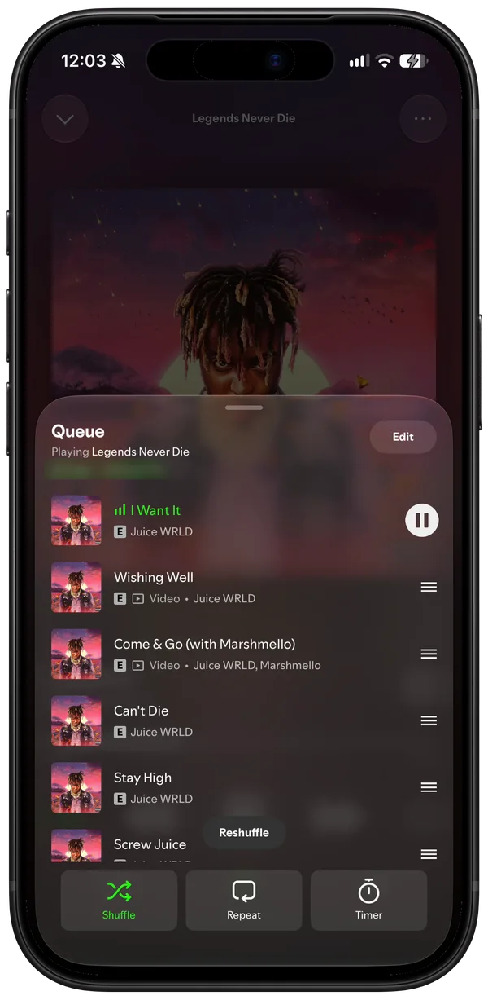

<p align="right"><a href="README.md">한국어</a> · <b>English</b></p>

<p align="center">
  
</p>

<h1 align="center">Retrine</h1>

<p align="center">
  <b>Spotify for iOS, rebuilt in Liquid Glass.</b><br>
  A no-jailbreak tweak you inject into your own decrypted Spotify IPA.
</p>

<p align="center">
  
  
  <a href="LICENSE"></a>
</p>

<p align="center">
  <a href="#build-it-yourself">Build</a> ·
  <a href="#signing-and-bundle-id">Signing</a> ·
  <a href="#wireguard--proxy">WireGuard</a> ·
  <a href="docs/tweaks.md">Developer guide</a> ·
  <a href="https://github.com/oneulddu/Retrine/issues/new/choose">Report a bug</a>
</p>

<p align="center">
  
  
  
  
  
  
</p>

> [!NOTE]
> **Retrine is a fork of [Vitrine](https://github.com/My-Name-Is-Jeff/vitrine).**

## About

Retrine is a Theos tweak (Objective-C + Logos) that rebuilds Spotify for iOS in Liquid Glass. It is
injected into a decrypted Spotify IPA you supply and signed with your own certificate, so no jailbreak
is needed.

Vitrine, which Retrine forks, is itself a fork of [spoti.pw](https://github.com/skopevoj/spoti.pw) by
Vojtěch Škopek, taken from 0.21.1 (commit `c790445`, 2026-09-23), the last version released under
GPL-3.0, and modified since.

**No IPA is distributed.** You build it yourself from your own Spotify IPA: in your browser with GitHub
Actions, or on a Mac.

## Features

The **Redesigned UI** switch at the top of Mod Settings picks one of two looks, read once at launch:

- **Redesign**: the mod's own Liquid Glass look, built from a clean sheet. None of the native-look tweaks run.
- **Spotify's own look**: Spotify's screens with tweaks on top: hide switches, glass header buttons, a Home
  gradient, AMOLED and an accent color.

Everything that doesn't draw on Spotify's screens (ads, privacy, lyrics sources, gestures, blocked artists,
Vibrations, speed and pitch, the Live Activity) works the same under both. Open Mod Settings by holding Home
on the tab bar, from the first row of the side drawer, or from the last row of Spotify's Settings.

### Redesign: Liquid Glass and an Apple Music–style player

- Glass tab bar, search field and now playing bar, plus Split Tabs
- A redesigned full screen player and lyrics page with Apple Music–style lyrics always on, a live preview
  and style presets (text size, line spacing, blur, glow, wave)
- A decluttered Home, Search categories on tinted glass, a Library with one large title, and playlist,
  album and artist pages laid out the way the Music app does it, with a pinned ⋯ that opens the system menu
- Black throughout, with its own accent color (Spotify, Apple Music or custom)

### iPad

- On a regular-width iPad, the expanded player splits into two columns: artwork and controls on one side,
  lyrics or the queue on the other, in both orientations
- The now playing bar becomes a capsule mini player with shuffle, repeat, lyrics and queue next to the
  artwork, title and play button

### Lyrics

- Sources asked in order or all at once: imported lyrics, Spicy Lyrics, BiniLyrics, LyricsPlus, Musixmatch,
  Unison, Deezer, NetEase, PetitLyrics, LRCLIB, Bugs, Genie, QQ Music, KuGou and Genius
- Word-by-word timing where a source has it; in the redesign, pick another source for the playing song
  from the player's ⋯
- Pronunciation (Latin or Hangul, Romaji or Hiragana for Japanese) and translation via Apple Translate,
  Apple Intelligence or Gemini with your own API key
- The current line on the lock screen, and on iOS 26 the lyrics as the lock screen's full-screen artwork
- Karaoke: turns a song's vocals down on the device

### Ads and Premium state

- **Hide ads**, **Hide upsells** and **Spoof Premium**, ported from EeveeSpotify Reincarnated. The
  first-launch tour sets all three with one **No ads** switch.
- With Spoof Premium on, the full DJ stays available and album pages get **Add to Queue**

### Playback and audio

- Audio effects: Graphic EQ, presets, AutoEq headphone corrections, reverb, crossfeed, and more
- Spotify's own Automix and Crossfade, set from one page; speed and pitch
- Vibrations: haptic feedback on controls, plus support for iOS Music Haptics
- Double-tap zones on the player and AirPods head gestures
- Skips blocked artists and songs; SponsorBlock for podcasts (off by default)
- Listening stats kept on the device; telemetry blocking and tracking removed from shared links

### Live Activity

- On the lock screen and in the Dynamic Island (iOS 17+): the line being sung, the tracks up next, or a
  control view with playback controls, the queue and a sleep timer

### App-local WireGuard / proxy

- App-local WireGuard or proxy routing for Spotify. Off until you set it up; read the
  [caveats](#wireguard--proxy) first.

## Requirements

| | |
|---|---|
| Spotify | Decrypted IPA of **9.1.90**, **9.2.0** (release base), or **9.2.2**. On other versions Retrine shows a warning, not a launch block. |
| Redesign | **iOS 26+** |
| Spotify's own look | iOS 16.1+ |
| Live Activity | iOS 17+ |
| WireGuard / proxy | Spotify 9.1.90, 9.2.0 or 9.2.2; proxy routing needs iOS 17+ |

The mod hooks Spotify's own classes, which change between releases, so any other version may build and then
break. The redesign uses `UIGlassEffect`, which only exists from iOS 26. Below that, the Redesigned UI switch
turns it on only after a warning that it is untested there, and if a launch with it hangs, the next launch
goes back to Spotify's own look with everything else the mod adds still on top.

## Build it yourself

You need a decrypted Spotify IPA of a supported version. On 9.2.0 the default result is `retrine-<version>-pixie.ipa`,
ready to sign with SideStore, Feather or any certificate signer.

Releases have no `.deb` either: injected by hand, the tweak alone misses the app changes the redesign needs
(its glass tab bar), the Live Activity, Music Haptics in the background and Connect's local discovery.
Build the IPA instead.

### With GitHub Actions (no Mac needed)

1. Fork this repository and enable Actions in your fork's **Actions** tab.
2. Open **Build IPA from your own Spotify IPA** and press **Run workflow**.
3. Fill in the inputs below and start the run.
4. When it finishes, download `retrine.ipa` from the run's **Artifacts**.

| Input | Default | Description |
|---|---|---|
| Decrypted Spotify IPA URL | (required) | A direct download link to your decrypted IPA (Dropbox share links work too). The link is masked in the log. |
| Where to put the result | `artifacts` | `artifacts`, `filebin` or `both`. With filebin, the run summary gets a filebin.net link that is deleted after a few days of inactivity. |
| Remove every app extension (PlugIns/) | Off | Removes every app extension from the IPA. See [Signing](#signing-and-bundle-id). |
| Include app-local WireGuard / proxy | On | See [WireGuard](#wireguard--proxy) for routing requirements. |
| Include Pixie native downloads | On | Requires the exact supported 9.2.0, 9.2.2 or 9.1.90 build. |
| Bundle ID | `app.retrine.player` | Must match your signing App ID; extension IDs follow it. Type `com.spotify.client` to keep Spotify's ID. See [Signing](#signing-and-bundle-id). |

The downloaded file is checked first, so an HTML login page or a truncated download fails right away.

<details>
<summary><b>Build on a Mac</b></summary>

<br>

Install Theos in `~/theos` and Xcode with an iPhoneOS 26+ SDK (select it with `xcode-select`). An SDK in
`~/theos/sdks` alone requires `PIXIE=0` and omits the Live Activity and Open in Retrine extensions.

```sh
brew install make ldid dpkg zsign libimobiledevice
uv tool install "cyan @ git+https://github.com/asdfzxcvbn/pyzule-rw"
```

Default IPA builds include WireGuard and need the exact Go release pinned in `WireGuard/go.mod`.
`WIREGUARD=0` leaves WireGuard out and needs no Go.

Put the decrypted `.ipa` in `ipa/` (`Spotify-9.2.0.ipa` is picked first if present; choose another with
`IPA=`), then:

```sh
make release                 # out/retrine-<version>-pixie.ipa on 9.2.0
make release PIXIE=0         # without Pixie: out/retrine-<version>.ipa
make release NO_PLUGINS=1    # remove every app extension
make install                 # build, sign with your certificate and install on the device
```

A Mac build keeps Spotify's `com.spotify.client` unless you name a bundle ID. To change it, set it in the
environment: `BUNDLE_ID=<your App ID> make release`. (The GitHub Actions build defaults to
`BUNDLE_ID=app.retrine.player`.)

`make install` reads `SIGN_P12`, `SIGN_PROFILE` and `SIGN_P12_PASSWORD` from `.signing.env`; copy
`.signing.env.example` and fill it in.

The first build spends about a minute reading Spotify's flags out of your IPA; `make flags` regenerates
them.

`scripts/pipeline.sh <ipa> --no-flex --keep-watch` keeps Spotify's Apple Watch app (**untested**). Only its
arm64 build survives decryption on an iPhone, so it can run only on an Apple Watch Series 9, Ultra 2 or
newer, and it needs a signer that renames the Watch app to your App ID and signs it with a profile of its own
that includes the Watch. `make install` does not do that yet.

</details>

## Signing and bundle ID

- **The GitHub Actions build defaults to `app.retrine.player`.** It installs as an app of its own, beside
  the real Spotify.
- **Build with Spotify's ID (`com.spotify.client`)** and the app installs over the real Spotify, replacing
  it. Signing with a free Apple ID registers that ID with your Apple account. Reports of free accounts
  losing the ability to sign have grown lately; the cause is not confirmed, but it is why this is no longer
  the default.
- **If you installed a build made with the old default**, an IPA built with the new one installs as a
  separate app, and your login, settings and downloads do not carry over. Type `com.spotify.client` to keep
  updating the app you have.
- **The bundle ID must match your certificate's App ID.** The app extensions' IDs follow it. If it
  doesn't match, the app still works, but tapping the player on the lock screen won't open it; the app tells
  you on first launch which ID to use.
- In Feather, copy the App ID into **Identifier** and leave **PPQ protection** off. AltStore, SideStore and
  Sideloadly get this right on their own.
- **Free Apple ID**: a free account can register only a limited number of App IDs, and every app extension
  needs one, so you will usually need **Remove every app extension**. That also drops the Live Activity, the
  Open in Retrine share action and Spotify's own widget, Siri and notification extensions.
- A free Apple ID's signature lasts 7 days. Mod Settings shows when it runs out.

## WireGuard / proxy

> [!WARNING]
> This is **not a leak-proof or device-wide VPN**. It routes the Spotify paths that were inspected through the
> tunnel or proxy, and blocks the guarded paths when it can't. Don't treat it as a security boundary.

- It is included in the build by default, but stays off until you import a `.conf` or save a proxy, enable
  it and restart Spotify.
- Not covered: background sessions, web sign-in, AVURLAsset, traffic before the tweak initializes,
  local-network exemptions and playback on other Connect devices.
- WireGuard checks the exact Spotify build before enabling transport hooks.
- A build without WireGuard drops all enforcement, even if it was enabled before.

Full coverage and limitations: [docs/wireguard.md](docs/wireguard.md)

## Pixie native downloads (experimental)

IPA builds include Pixie's native download manager by default. Only the exact supported Spotify
9.2.0, 9.2.2 and 9.1.90 builds are accepted. To build without it, use `PIXIE=0` (`--no-pixie` with the pipeline).
On 9.2.0 and 9.2.2, downloads, persistence across a restart and deletion were verified on a real device; on 9.2.2 also album downloads, offline playback and M4A/Ogg export.
Long-term offline licence renewal remains unverified.
See [docs/pixie.md](docs/pixie.md) for supported builds and limitations.

## Updates

**Mod Settings → Mod → Updates** checks this repository's
[GitHub Releases](https://github.com/oneulddu/Retrine/releases) and shows the changelog of every newer
release. When a new release comes out, a sheet appears a few seconds after Spotify opens, once per release.
Betas are counted only while **Include betas** is on (on by default for a beta build).

Releases don't attach an IPA. To update, sync your fork and run the workflow again (or pull and run
`make release` on your Mac).

## Bug reports and feature requests

Use this repository's [Issues](https://github.com/oneulddu/Retrine/issues/new/choose) and pick the
**Bug report** or **Feature request** template. Your mod and Spotify versions are in
**Mod Settings → Mod**, and **Export settings** on the same page makes setting-specific bugs much easier to
track down.

## For developers

- [docs/tweaks.md](docs/tweaks.md): project layout, layers and how each feature works
- [AGENTS.md](AGENTS.md): a short summary of the code rules
- [docs/wireguard.md](docs/wireguard.md): WireGuard / proxy design and verification

## Credits

- [spoti.pw](https://github.com/skopevoj/spoti.pw) by Vojtěch Škopek, the original project
- [Vitrine](https://github.com/My-Name-Is-Jeff/vitrine), the project Retrine forks
- [cyan](https://github.com/asdfzxcvbn/pyzule-rw) injects, [Theos](https://theos.dev) builds, and
  [FLEX](https://github.com/FLEXTool/FLEX), as hopeless's AutoFLEX build in `vendor/`, is the inspector the
  view trees are read through
- Ad blocking and the Premium state are ported from
  [EeveeSpotify Reincarnated](https://github.com/SideloadLabs/EeveeSpotifyReincarnated)
- Pixie native downloads come from [Glongq/Vitrine-Pixie](https://github.com/Glongq/Vitrine-Pixie); see
  [docs/pixie.md](docs/pixie.md) for the full attribution
- The audio effects' third-party code and its licenses are listed in [vendor/audio](vendor/audio/README.md)

## License

[GPL-3.0](LICENSE). Not affiliated with Spotify.
