<p align="right"><b>한국어</b> · <a href="README.en.md">English</a></p>

<p align="center"></p>

<h1 align="center">Retrine</h1>

<p align="center">
  <strong>iOS용 Spotify에 Liquid Glass 플레이어와 싱크 가사를 더합니다.</strong><br>
  직접 준비한 Spotify IPA를 빌드하고 서명해 탈옥 없이 사용하세요.
</p>

<p align="center">
  
  
  
  <a href="LICENSE"></a>
  <a href="https://github.com/oneulddu/Retrine/releases"></a>
</p>

<p align="center">
  <a href="#두-가지-화면">화면 비교</a> ·
  <a href="#플레이어와-가사">플레이어와 가사</a> ·
  <a href="#직접-빌드하기">빌드</a> ·
  <a href="#서명과-번들-id">서명</a> ·
  <a href="docs/tweaks.md">개발 문서</a> ·
  <a href="https://github.com/oneulddu/Retrine/issues/new/choose">버그 제보</a>
</p>

Retrine은 [Vitrine](https://github.com/My-Name-Is-Jeff/vitrine)에서 갈라져 나온 Theos 트윅(Objective-C + Logos)입니다. **완성된 IPA는 배포하지 않습니다.** 지원 버전의 복호화된 Spotify IPA를 준비해 GitHub Actions나 Mac에서 빌드하세요.

## 화면 미리보기

<table align="center">
  <tr>
    <td align="center"><a href="docs/screenshots/now-playing.webp">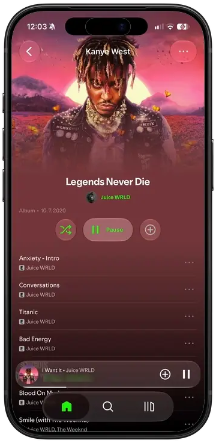</a><br><sub>전체 화면 가사</sub></td>
    <td align="center"><a href="docs/screenshots/album.webp">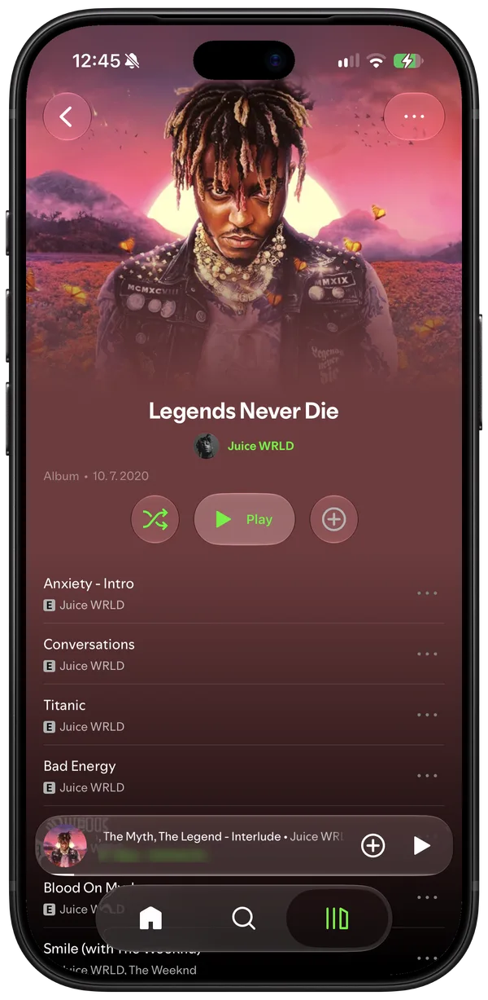</a><br><sub>앨범</sub></td>
    <td align="center"><a href="docs/screenshots/playlist.webp">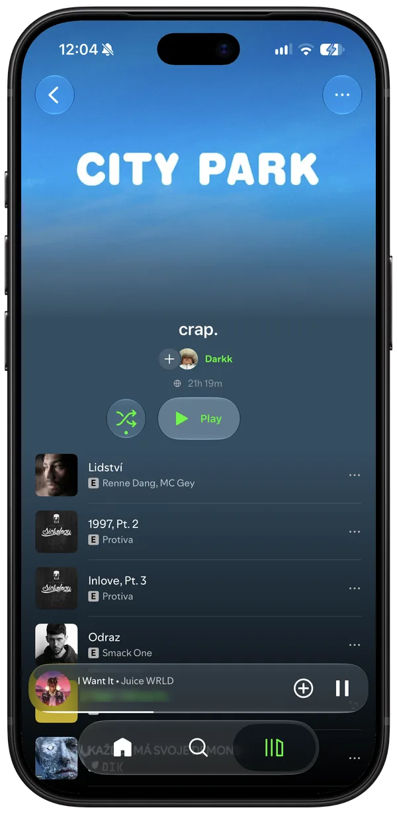</a><br><sub>플레이리스트</sub></td>
  </tr>
  <tr>
    <td align="center"><a href="docs/screenshots/queue.webp">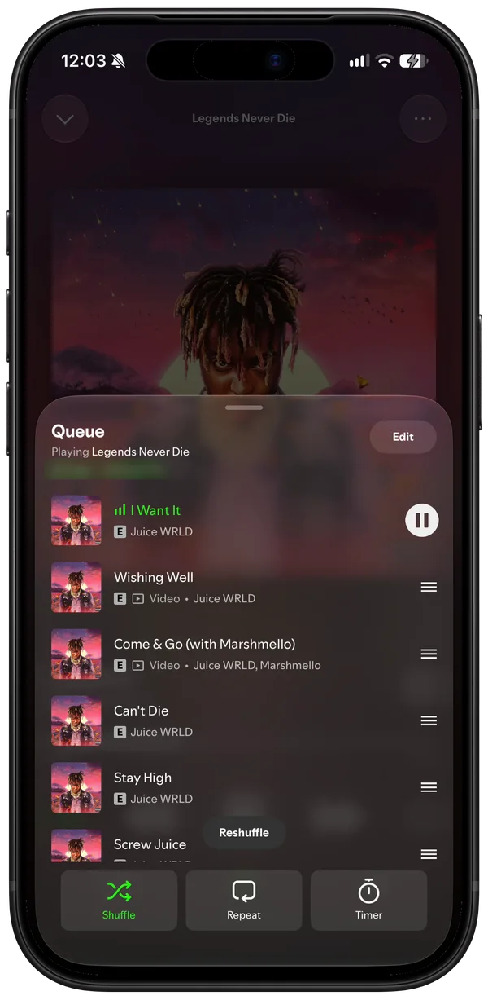</a><br><sub>재생 대기열</sub></td>
    <td align="center"><a href="docs/screenshots/live-activity.webp">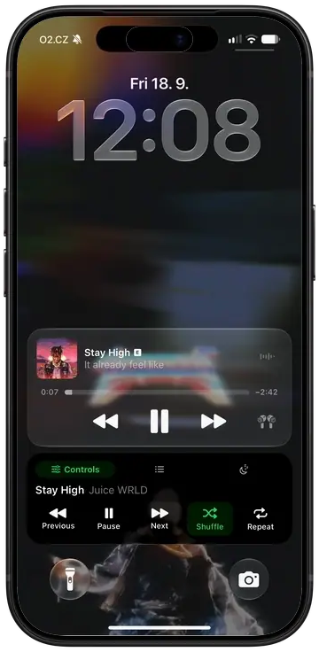</a><br><sub>잠금 화면의 Live Activity</sub></td>
    <td align="center"><a href="docs/screenshots/home.webp">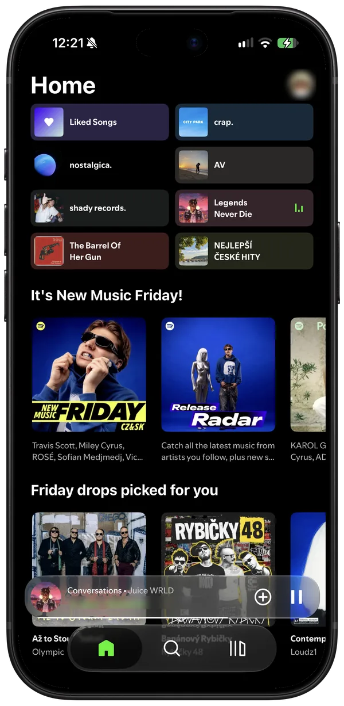</a><br><sub>홈</sub></td>
  </tr>
</table>

## 두 가지 화면

**모드 설정 → 재설계 UI**에서 화면을 고르고 Spotify를 다시 엽니다. 모드 설정은 탭 바의 **홈을 길게 누르거나**, 사이드 메뉴 첫 줄 또는 Spotify 설정 맨 아래에서 열 수 있습니다.

| | 재설계 화면 | Spotify 기본 화면 |
|---|---|---|
| 지원 환경 | iOS 26 이상 · Liquid Glass | iOS 16.1 이상 · Spotify의 기존 화면 |
| 탐색 | 글래스 탭 바·검색창·재생 바, 탭 분리(Split Tabs) | 화면 요소 숨기기, 글래스 헤더 버튼 |
| 화면 구성 | 간결한 홈, 색을 입힌 글래스 검색 카테고리, 큰 제목 하나로 정리한 보관함. 앨범·플레이리스트·아티스트 페이지에는 시스템 메뉴를 여는 ⋯ 버튼이 고정됩니다. | 홈 그라데이션, AMOLED 모드와 강조 색상을 각각 선택할 수 있습니다. |
| 플레이어 | Apple Music 스타일 가사, 선택 가능한 Apple Music 대기열, 검은 바탕에 Spotify·Apple Music·사용자 지정 강조 색상 | Spotify의 플레이어와 탐색 방식을 유지합니다. |

재설계 화면에서는 기본 화면용 트윅이 꺼집니다. 광고·개인정보 보호, 가사 소스, 제스처, 차단 목록, 진동, 속도·피치, Live Activity는 두 화면에서 함께 쓸 수 있습니다.

설정 검색으로 원하는 항목을 바로 찾을 수 있습니다. 직접 둘러볼 때는 **모양 및 탐색**, **화면**, **오디오 및 재생**, **Spotify 외부 및 기기**, **개인정보 보호, 네트워크 및 다운로드**, **고급 및 정보**의 여섯 구역을 이용하세요.

**앱 아이콘**은 **화면 모양 → 앱 아이콘**에서 여섯 가지 중 고를 수 있습니다.

<p align="center">
  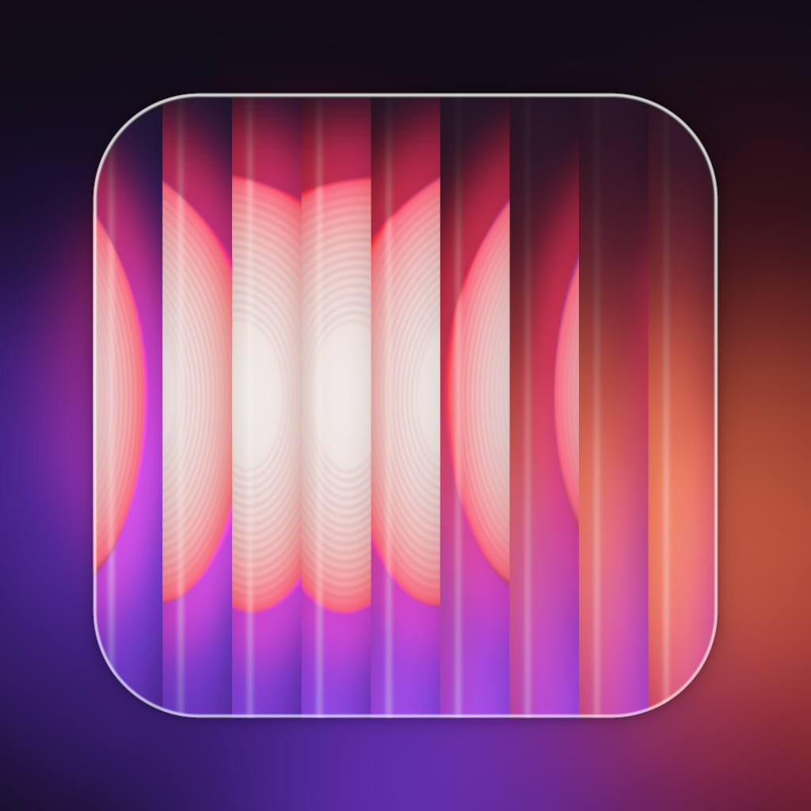
  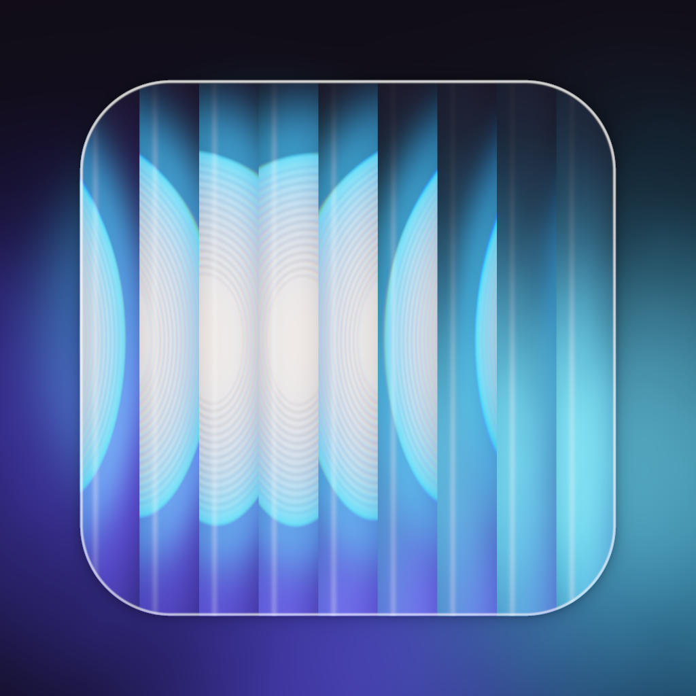
  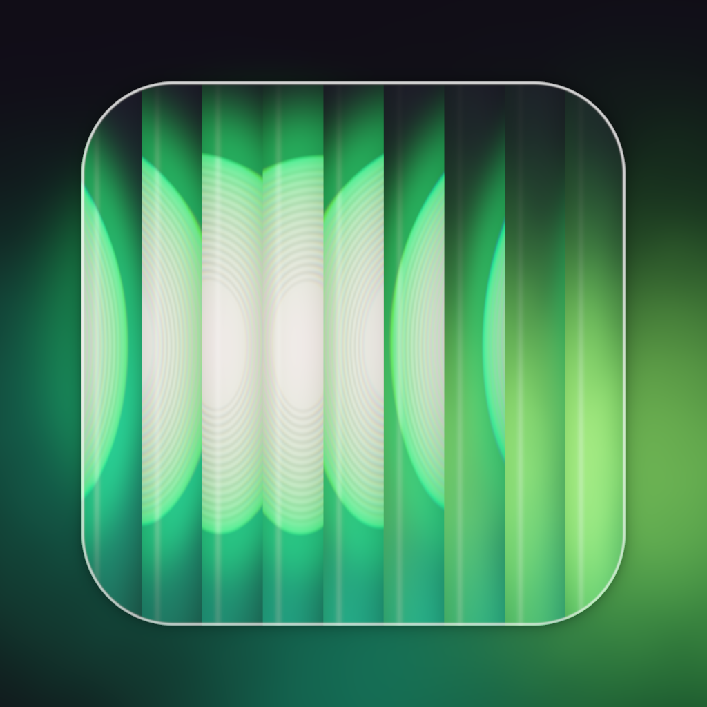
  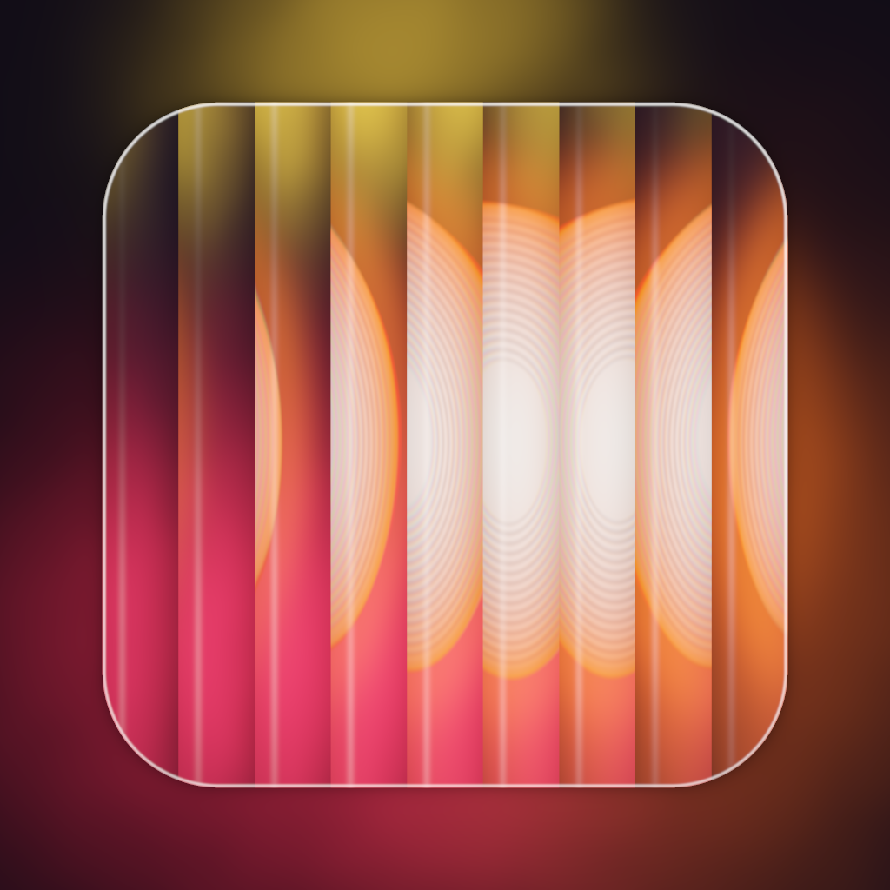
  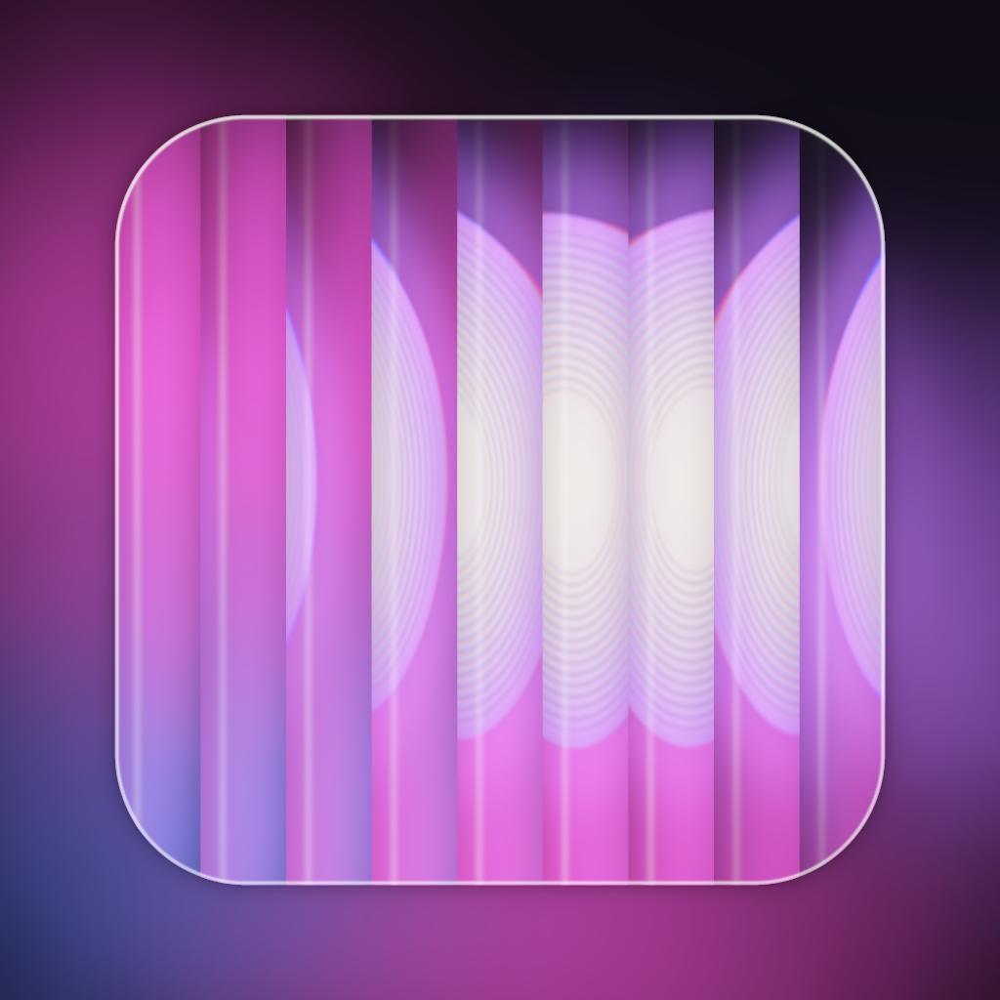
  
</p>

## 플레이어와 가사

재설계 플레이어에서는 앨범 커버와 가사, 대기열을 한 화면에서 오갈 수 있습니다. 가사 화면에는 항상 Apple Music 스타일이 적용됩니다. 글자 크기, 줄 간격, 블러, 글로우, 웨이브를 프리셋과 실시간 미리보기로 조정할 수 있습니다.

| 플레이어 배경 | 화면에 보이는 것 |
|---|---|
| Still · Colors | Still은 흐린 앨범 커버를 고정하고, Colors는 커버에서 뽑은 색을 천천히 움직입니다. |
| Fluid | 커버가 흐르듯 움직이다가 일시 정지하면 멈춥니다. 지원 기기에서는 GPU로 그리는 Smooth를 선택할 수 있습니다. |
| Animated | 곡의 Canvas나 앨범의 움직이는 커버를 보여 줍니다. 클립이 없는 곡은 Fluid 위의 커버, 전체 화면 커버, Visualizer 중에서 고릅니다. |
| Visualizer | Hills·Bars·Nebula·Halo는 소리에 반응하고, Lyrics·Poster·Cut은 싱크 가사에 맞춰 움직입니다. |
| Black · Your Photo | 검은 배경이나 직접 고른 사진을 씁니다. 사진은 가사가 잘 읽히도록 어둡게 표시됩니다. |

**재생 대기열.** iPhone의 기본 대기열은 Spotify 방식입니다. **모드 설정 → 플레이어 → 대기열**에서 **Apple Music**을 고르고 Spotify를 다시 시작하면 플레이어 안에서 셔플·반복·수면 타이머·AutoMix를 조작하고 곡 옆 손잡이를 끌어 순서를 바꿀 수 있습니다.

같은 플레이어 설정에서 최근 재생 목록을 표시하거나 숨길 수 있습니다. 대기열의 **지우기**는 이 화면에 표시된 항목만 숨기며, Spotify 계정의 청취 기록은 유지됩니다.

**iPad.** 가로 폭이 넉넉한 화면에서는 가로·세로 방향 모두 커버와 컨트롤이 한쪽에, 가사나 대기열이 다른 쪽에 놓입니다. 캡슐형 미니 플레이어에는 커버·제목·재생 버튼 옆에 셔플·반복·가사·대기열이 있습니다.

### 가사와 오프라인 저장

- 가사 소스를 순서대로 또는 동시에 조회합니다. 단어별 타이밍을 제공하는 소스에서는 단어 단위로 따라갈 수 있고, 재설계 플레이어의 ⋯에서 현재 곡의 소스를 바꿀 수 있습니다.
- 가사를 기기에 저장해 오프라인에서 읽을 수 있습니다. Pixie를 쓰면 다운로드한 곡의 가사도 자동으로 저장하도록 설정할 수 있습니다.
- 발음은 라틴 문자·한글로, 일본어는 로마자·히라가나로 표시할 수 있습니다. 번역은 Apple 번역, Apple Intelligence 또는 본인 API 키를 쓰는 Gemini를 지원합니다. 노래방 모드는 기기에서 곡의 보컬을 줄입니다.
- 잠금 화면에는 현재 가사 한 줄을, iOS 26에서는 전체 화면 아트워크로 가사를 표시할 수 있습니다.

<details>
<summary>지원하는 가사 소스</summary>

가져온 가사, Spicy Lyrics, BiniLyrics, LyricsPlus, Musixmatch, Unison, Deezer, NetEase, PetitLyrics, LRCLIB, Bugs, Genie, QQ Music, KuGou, Genius.

</details>

### 두 화면의 공통 기능

| 기능 | 할 수 있는 일 |
|---|---|
| 재생과 오디오 | 그래픽 EQ와 프리셋, AutoEq 헤드폰 보정, 리버브, 크로스피드, 속도·피치를 조절합니다. Spotify의 Automix와 크로스페이드도 한 페이지에서 설정합니다. |
| 제스처와 진동 | 플레이어의 더블 탭 영역, AirPods 머리 제스처, 컨트롤 햅틱과 iOS 음악 햅틱을 지원합니다. |
| 차단과 개인정보 | 차단한 곡·아티스트를 건너뜁니다. 팟캐스트용 SponsorBlock은 기본으로 꺼져 있습니다. 청취 통계는 기기에만 저장하며, 텔레메트리를 차단하고 공유 링크에서 추적 정보를 지울 수 있습니다. |
| 광고와 Premium 상태 | 첫 실행의 **광고 없음**으로 광고 숨기기·업셀 숨기기·Premium 위장을 함께 켭니다. Premium 위장을 켜면 전체 DJ 기능과 앨범 페이지의 **대기열에 추가**를 쓸 수 있습니다. |
| Live Activity | iOS 17 이상에서 잠금 화면과 Dynamic Island에 현재 가사, 다음 곡 목록 또는 재생·대기열·수면 타이머 컨트롤을 표시합니다. |
| 네트워크 | Spotify 앱 안에서 WireGuard나 프록시를 사용할 수 있습니다. 직접 설정한 뒤 켜야 합니다. [적용 범위와 한계](#wireguard--프록시) |

## 요구 사항

| 항목 | 지원 범위 |
|---|---|
| Spotify | **9.1.90**, **9.2.0**(배포 기준 버전), **9.2.2**의 복호화된 IPA. 다른 버전에서는 경고를 표시하지만 실행을 막지는 않습니다. |
| 재설계 화면 | **iOS 26 이상** |
| Spotify 기본 화면 | iOS 16.1 이상 |
| Live Activity | iOS 17 이상 |
| WireGuard / 프록시 | Spotify 9.1.90, 9.2.0 또는 9.2.2. 프록시 라우팅은 iOS 17 이상 |

이 모드는 Spotify 내부 클래스를 후킹하는데, 이 클래스들은 버전마다 바뀝니다. 그래서 다른 버전은 빌드는
되더라도 동작이 깨질 수 있습니다. 재설계 화면은 iOS 26부터 있는 `UIGlassEffect`를 씁니다. 그보다 낮은
버전에서는 테스트되지 않았다는 경고를 확인해야만 재설계 UI를 켤 수 있고, 재설계 화면으로 실행하다 멈추면
다음 실행은 Spotify 기본 화면으로 돌아갑니다. 이때도 모드의 나머지 기능은 그대로 유지됩니다.

## 직접 빌드하기

지원 버전의 복호화된 Spotify IPA가 필요합니다. 9.2.0을 기본 설정으로 빌드하면 `retrine-<version>-pixie.ipa`가 나오고,
이를 SideStore, Feather 등 원하는 서명 도구로 서명하면 됩니다.

릴리스에는 `.deb`도 없습니다. 트윅만 손으로 주입하면 재설계 화면에 필요한 앱 변경(글래스 탭 바),
Live Activity, 백그라운드 음악 햅틱, Connect 로컬 기기 검색이 빠지기 때문입니다. IPA로 빌드하세요.

### GitHub Actions로 빌드 (Mac 불필요)

1. 이 저장소를 포크하고, 포크한 저장소의 **Actions** 탭에서 Actions를 켭니다.
2. 포크의 **Actions → Build IPA from your own Spotify IPA → Run workflow**를 선택합니다.
3. 아래 입력값을 채우고 실행합니다.
4. 기본값을 사용했다면 완료된 실행의 **Artifacts → retrine.ipa**를 받아 압축을 풉니다. `filebin`을 골랐다면 실행 요약의 다운로드 링크를 엽니다.

| 입력값 | 기본값 | 설명 |
|---|---|---|
| Decrypted Spotify IPA URL | (필수) | 복호화된 IPA의 직접 다운로드 링크(Dropbox 공유 링크도 가능). 링크는 로그에서 가려집니다. |
| Where to put the result | `artifacts` | `artifacts`, `filebin`, `both` 중 선택. filebin을 고르면 실행 요약에 filebin.net 링크가 표시되며, 며칠 동안 쓰지 않으면 삭제됩니다. |
| Remove every app extension (PlugIns/) | 꺼짐 | IPA에서 앱 확장을 모두 제거합니다. [서명](#서명과-번들-id) 항목을 참고하세요. |
| Include app-local WireGuard / proxy | 켜짐 | 라우팅 요구 사항은 [WireGuard](#wireguard--프록시) 항목을 참고하세요. |
| Include Pixie native downloads | 켜짐 | 지원 대상인 9.2.0, 9.2.2 또는 9.1.90 빌드와 정확히 일치해야 합니다. |
| Bundle ID | `app.retrine.player` | 서명할 App ID와 같아야 하며, 앱 확장 ID도 이를 따라갑니다. Spotify의 ID를 유지하려면 `com.spotify.client`를 직접 입력합니다. [서명](#서명과-번들-id) 항목을 참고하세요. |
| macOS runner | `macos-latest` | `macos-latest`(Apple Silicon)와 `macos-26-intel`(Intel)은 모두 Xcode 26.6을 사용합니다. 30초 안에 러너가 배정되지 않으면 같은 커밋으로 다른 러너에서 다시 시도합니다. 최대 다섯 번 전환한 뒤에는 마지막 러너를 기다립니다. |

내려받은 파일은 먼저 검사하므로, HTML 로그인 페이지나 중간에 끊긴 파일이면 바로 실패합니다.

<details>
<summary><b>Mac에서 빌드</b></summary>

<br>

Theos를 `~/theos`에 설치하고, iPhoneOS 26 이상 SDK가 있는 Xcode를 `xcode-select`로 선택합니다.
`~/theos/sdks`의 SDK만 쓴다면 `PIXIE=0`으로 빌드해야 하며, Live Activity와 Open in Retrine 확장도 빠집니다.

```sh
brew install make ldid dpkg zsign libimobiledevice
uv tool install "cyan @ git+https://github.com/asdfzxcvbn/pyzule-rw"
```

기본 IPA 빌드에는 WireGuard가 포함되며, `WireGuard/go.mod`에 고정된 Go 버전이 정확히 필요합니다.
`WIREGUARD=0`으로 빌드하면 WireGuard가 빠지고 Go도 필요 없습니다.

복호화된 `.ipa`를 `ipa/`에 넣고(`Spotify-9.2.0.ipa`가 있으면 그것을 먼저 쓰며, 다른 파일은 `IPA=`로
지정) 다음을 실행합니다.

```sh
make release                 # 9.2.0: out/retrine-<version>-pixie.ipa
make release PIXIE=0         # Pixie 제외: out/retrine-<version>.ipa
make release NO_PLUGINS=1    # 앱 확장 모두 제거
make install                 # 빌드 후 본인 인증서로 서명해 기기에 설치
```

Mac에서 `make release`로 만든 IPA는 번들 ID를 따로 지정하지 않으면 Spotify의 `com.spotify.client`를 유지합니다. 바꾸려면
환경 변수로 지정합니다: `BUNDLE_ID=<본인 App ID> make release` (GitHub Actions 빌드의 기본값은
`BUNDLE_ID=app.retrine.player`입니다.)

`make install`은 `.signing.env`에서 `SIGN_P12`, `SIGN_PROFILE`, `SIGN_P12_PASSWORD`를 읽습니다.
`.signing.env.example`을 복사해 채워 넣으세요.

첫 빌드는 IPA에서 Spotify의 플래그를 읽느라 1분 정도 걸립니다. `make flags`로 다시 생성할 수 있습니다.

`scripts/pipeline.sh <ipa> --no-flex --keep-watch`를 쓰면 Spotify의 Apple Watch 앱을 남깁니다(**테스트되지
않음**). iPhone에서 복호화하면 arm64 빌드만 살아남기 때문에 Apple Watch Series 9, Ultra 2 이후 모델에서만
실행할 수 있고, Watch 앱 이름을 본인 App ID에 맞게 바꾸고 Watch가 포함된 별도 프로필로 서명해 주는 서명
도구가 필요합니다. `make install`은 아직 이를 지원하지 않습니다.

</details>

## 서명과 번들 ID

| 번들 ID | 설치 결과 |
|---|---|
| `app.retrine.player` · GitHub Actions 기본값 | 정식 Spotify와 나란히 설치됩니다. 예전 기본값으로 설치한 앱의 로그인·설정·다운로드는 새 앱으로 넘어오지 않습니다. |
| `com.spotify.client` · Mac의 `make release` 기본값 | 최종 서명 ID가 `com.spotify.client`이면 정식 Spotify를 대체합니다. 예전 기본값으로 설치한 Retrine을 업데이트할 때도 이 ID로 서명하세요. |

Mac에서 `make install`을 실행하면 프로비저닝 프로필에 명시된 App ID로 다시 서명합니다. 와일드카드 프로필이면 IPA의 번들 ID를 유지합니다.

**번들 ID를 서명 인증서의 App ID와 맞추세요.** 앱 확장 ID도 이를 따릅니다. ID가 달라도 앱은 실행되지만 잠금 화면의 플레이어를 눌러 앱을 열 수 없습니다. 첫 실행 안내에서 필요한 ID를 확인할 수 있습니다.

<details>
<summary>서명 도구와 무료 Apple ID</summary>

- Feather에서는 App ID를 **Identifier**에 넣고 **PPQ protection**을 끕니다. AltStore, SideStore, Sideloadly는 자동으로 설정합니다.
- 무료 Apple ID 서명은 **7일** 동안 유효합니다. 모드 설정에서 만료일을 확인하세요.
- 무료 계정은 등록할 수 있는 App ID 수가 제한되고 확장마다 ID가 하나씩 필요하므로, 대개 **Remove every app extension**을 켜야 합니다. 이 경우 Live Activity, Open in Retrine 공유 동작, Spotify의 위젯·Siri·알림 확장도 함께 빠집니다.
- 무료 계정으로 `com.spotify.client`에 서명하면 해당 ID가 본인 Apple 계정에 등록됩니다. 일부 무료 계정에서 서명이 막혔다는 제보가 늘어 GitHub Actions 기본값을 변경했습니다. 원인은 확인되지 않았습니다.

</details>

## WireGuard / 프록시

> [!WARNING]
> 이 기능은 **누출을 완전히 막아 주는 VPN도, 기기 전체에 적용되는 VPN도 아닙니다.** 검토된 Spotify
> 경로만 터널이나 프록시로 보내고, 그럴 수 없을 때는 보호 대상 경로를 차단합니다. 보안 경계로 여기지 마세요.

- 빌드에는 기본으로 포함되지만, `.conf`를 가져오거나 프록시를 저장하고, 직접 켠 뒤 Spotify를 다시
  시작하기 전까지는 꺼져 있습니다.
- 적용되지 않는 경로: 백그라운드 세션, 웹 로그인, AVURLAsset, 트윅 초기화 전의 트래픽, 로컬 네트워크
  예외, 다른 Connect 기기에서의 재생.
- WireGuard는 네트워크 훅을 활성화하기 전에 Spotify 빌드가 정확히 일치하는지 확인합니다.
- WireGuard 없이 빌드하면 이전에 켜 두었더라도 라우팅과 차단이 전혀 적용되지 않습니다.

적용 범위와 한계 전체: [docs/wireguard.md](docs/wireguard.md)

## Pixie 네이티브 다운로드 (실험적)

IPA에는 Pixie의 네이티브 다운로드 관리자가 기본으로 포함됩니다. 지원 대상인 Spotify 9.2.0, 9.2.2
또는 9.1.90 빌드와 정확히 일치해야 합니다. 제외하려면 `PIXIE=0`을 지정하세요(파이프라인에서는 `--no-pixie`).
9.2.0과 9.2.2에서 다운로드, 앱 재시작 후 다운로드 유지, 삭제를 실기기에서 확인했습니다. 9.2.2에서는 앨범 다운로드, 오프라인 재생, m4a·Ogg 내보내기도 확인했습니다.
장기 오프라인 라이선스 갱신은 아직 확인하지 않았습니다.
지원 빌드와 제한 사항은 [docs/pixie.md](docs/pixie.md)(영문)를 참고하세요.

## 업데이트

**모드 설정 → 모드 → 업데이트**는 이 저장소의 [GitHub Releases](https://github.com/oneulddu/Retrine/releases)를
확인해 더 새로운 릴리스의 변경 내역을 모두 보여 줍니다. 새 릴리스가 나오면 Spotify를 연 지 몇 초 뒤에
릴리스당 한 번 안내 시트가 뜹니다. 베타는 **베타 포함**이 켜져 있을 때만 확인합니다(베타 빌드에서는
기본으로 켜짐).

릴리스에는 IPA가 첨부되지 않습니다. 업데이트하려면 포크를 동기화(Sync fork)한 뒤 워크플로를 다시 실행하거나,
Mac에서 최신 코드를 받아 `make release`를 실행하세요.

## 버그 제보와 기능 제안

이 저장소의 [Issues](https://github.com/oneulddu/Retrine/issues/new/choose)에서 **Bug report** 또는
**Feature request** 템플릿을 골라 작성해 주세요. 모드와 Spotify 버전은 **모드 설정 → 모드**에 있고, 같은
페이지의 **설정 내보내기** 파일을 첨부하면 특정 설정에서만 생기는 버그를 훨씬 쉽게 찾을 수 있습니다.

## 개발자용 문서

- [docs/tweaks.md](docs/tweaks.md): 프로젝트 구조, 레이어, 각 기능의 동작 방식
- [AGENTS.md](AGENTS.md): 코드 규칙 요약
- [docs/wireguard.md](docs/wireguard.md): WireGuard / 프록시 설계와 검증

## 크레딧

Retrine의 기반인 [Vitrine](https://github.com/My-Name-Is-Jeff/vitrine)은 Vojtěch Škopek의 [spoti.pw](https://github.com/skopevoj/spoti.pw)에서 갈라져 나왔습니다. 출발점은 GPL-3.0으로 공개된 마지막 버전인 0.21.1(커밋 `c790445`, 2026-09-23)입니다.

- 주입은 [cyan](https://github.com/asdfzxcvbn/pyzule-rw), 빌드는 [Theos](https://theos.dev)가 맡고,
  화면 구조(view tree)는 [FLEX](https://github.com/FLEXTool/FLEX)(`vendor/`에 있는 hopeless의 AutoFLEX
  빌드)로 살펴봅니다
- 광고 차단과 Premium 상태는 [EeveeSpotify Reincarnated](https://github.com/SideloadLabs/EeveeSpotifyReincarnated)에서 가져왔습니다
- Pixie 네이티브 다운로드는 [Glongq/Vitrine-Pixie](https://github.com/Glongq/Vitrine-Pixie)에서 가져왔습니다.
  자세한 출처는 [docs/pixie.md](docs/pixie.md)를 참고하세요
- 오디오 효과에 쓰인 서드파티 코드와 라이선스는 [vendor/audio](vendor/audio/README.md)에 정리되어 있습니다

## 라이선스

[GPL-3.0](LICENSE). Spotify와는 관련이 없습니다.
